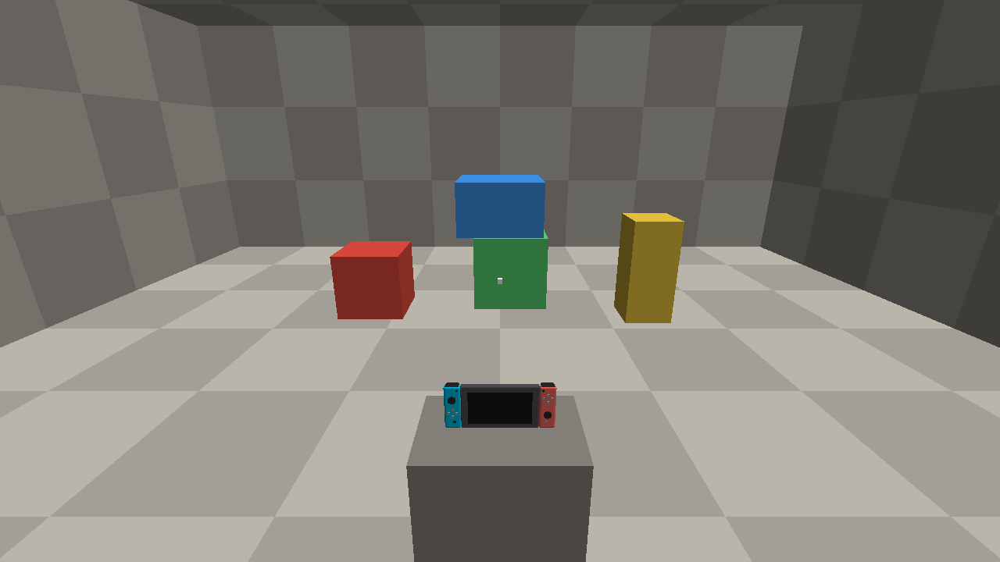
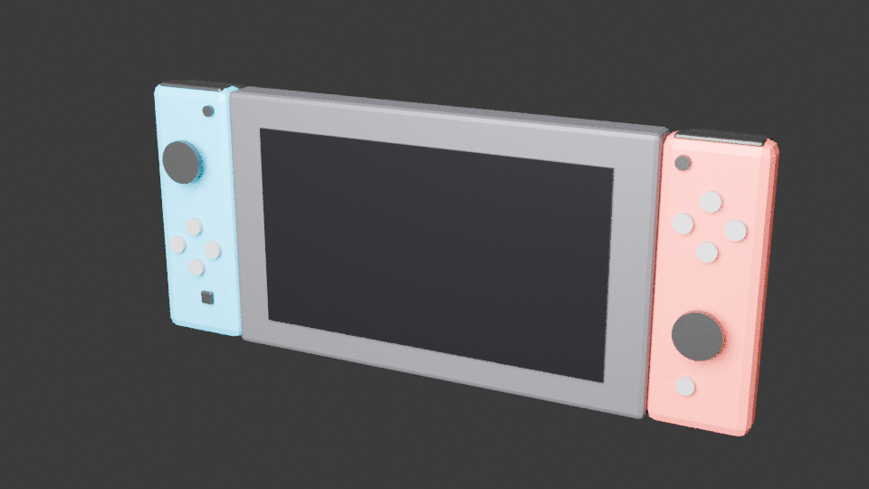

# Switch1 Welcome Tour Remake

给硬破 Switch 1（大气层 Atmosphere 自制系统）做的原创"走进 Switch 内部"导览小游戏，灵感来自 Switch 2 的 Welcome Tour，但房间、文字、模型、玩法全部自己做。C++ 编写，先在电脑上开发调试，再用 devkitPro 打包成 `.nro` 在 Switch 上跑。



## 素材规则（很重要）

- 仓库里不放任何任天堂的游戏文件、美术、音乐或代码。
- 不放导出的 NSP / NUP / 游戏数据，不复制任何素材。
- 代码、模型、美术全部原创，专门为这个项目做。音乐先不做。
- 公开仓库，只用于个人学习和规划。

## 现在有什么

第一个展厅：**重力展厅**。一个 8×3×8 米的房间，第一人称视角走动，几个方块受重力下落、弹跳、叠放，可以抓起来拖着走。入口前的展台上放着一台 1:1 的 Switch 1 模型。

代码结构：

| 目录 | 内容 |
| --- | --- |
| `src/physics` | 自己写的物理引擎：`Vec3`、刚体（轴对齐方块）、`Field` 场接口和第一个实现 `GravityField`、`World::step()` 固定步长 1/120 秒、方块互相碰撞和撞墙、射线拾取、弹簧拖拽 |
| `src/render` | 最小 OpenGL 3.3 渲染：自带的函数加载器、方块网格、带格子的房间、简单光照 |
| `src/input` | 电脑：键盘鼠标；Switch：摇杆、按键、触屏 |
| `src/platform` | 电脑和 Switch 不同的部分都在这里，用 `#ifdef __SWITCH__` 隔开 |
| `src/assets` | glTF（.glb）模型加载，用 [cgltf](https://github.com/jkuhlmann/cgltf)（MIT 协议，放在 `third_party/cgltf`） |
| `src/demo.*` | 重力展厅的场景（方块的位置、大小、颜色） |
| `tools/blender` | 用脚本生成模型的 Blender 脚本 |
| `assets/models` | 导出好的模型，电脑版放在程序旁边，Switch 版打包进 .nro 的 romfs |
| `tests` | 物理测试和模型测试，不需要显卡就能跑 |

以后加新的场（比如月球低重力区、风、磁铁）就是再写一个 `Field` 子类。

## 操作

| | 电脑 | Switch |
| --- | --- | --- |
| 走动 | WASD | 左摇杆 |
| 转视角 | 按住鼠标右键拖动 | 右摇杆，或手指在屏幕上拖 |
| 抓方块 | 准星对准，按住鼠标左键 | 准星对准，按住 ZR（或 R） |
| 重置 | R | X |
| 退出 | Esc | + |

## 在电脑上编译运行

需要：C++17 编译器、CMake 3.16 以上、SDL2。OpenGL 不用单独装，显卡驱动自带。

### Windows（推荐 MSYS2）

1. 安装 [MSYS2](https://www.msys2.org/)，打开 **MSYS2 UCRT64** 终端。
2. 装工具：
   ```
   pacman -S --needed mingw-w64-ucrt-x86_64-gcc mingw-w64-ucrt-x86_64-cmake mingw-w64-ucrt-x86_64-ninja mingw-w64-ucrt-x86_64-SDL2 git
   ```
3. 编译、测试、运行：
   ```
   cmake -S . -B build -G Ninja
   cmake --build build
   ctest --test-dir build --output-on-failure
   ./build/switch1-welcome-tour.exe
   ```

用 Visual Studio 也可以：装好 vcpkg 后 `vcpkg install sdl2`，再用 CMake 打开项目文件夹，配置时带上 vcpkg 的 toolchain 文件。

### Linux

```
sudo apt install build-essential cmake libsdl2-dev
cmake -S . -B build
cmake --build build
ctest --test-dir build --output-on-failure
./build/switch1-welcome-tour
```

### 调试用参数

```
./build/switch1-welcome-tour --frames 300 --screenshot shot.bmp
```

跑 300 帧后把最后一帧存成图片再退出，方便快速检查画面。

## 打包成 Switch 的 .nro

1. 按 [devkitPro 官方说明](https://devkitpro.org/wiki/Getting_Started) 装好 devkitPro（Windows 用官方安装器，会带 MSYS2 终端）。
2. 装 Switch 开发包：
   ```
   dkp-pacman -S switch-dev switch-sdl2 switch-mesa
   ```
3. 在项目根目录（devkitPro 的 MSYS2 终端里）：
   ```
   make
   ```
   生成 `switch1-welcome-tour.nro`。
4. 把它复制到 SD 卡的 `/switch/` 文件夹，插回 Switch，进大气层后按住 R 打开任意一个游戏进入 hbmenu，选它启动。不要从相册进 hbmenu：那样内存少，OpenGL 程序可能跑不起来。
5. 想在电脑上看 Switch 的输出日志：hbmenu 里按 Y 进 nxlink 等待，电脑上运行 `nxlink -s switch1-welcome-tour.nro`，`printf` 的内容会显示在电脑终端。

想换图标：放一张自己画的 256×256 `icon.jpg` 到项目根目录，不要用任天堂的图。

## 测试情况

- 电脑版（Linux）：编译通过，无警告；物理测试和模型测试全部通过；在虚拟显示上实际跑了画面，模型能加载显示（上面的截图）。
- 模型：Blender 4.0 无界面导出成功，尺寸 239.0 × 102.5 × 28.4 mm（高多出的 0.5 mm 是肩键）。按键位置和摇杆、扳机的厚度分配是估的，要用真机量了再改。
- Switch 版：Makefile 按 devkitPro 官方模板写的，**还没有编译和真机测试过**，Switch 上的按键编号和 romfs 里读模型也待真机确认。

## 建模

1:1 建模用的官方尺寸、拆机资料和零件清单见 [docs/modeling-reference.md](docs/modeling-reference.md)。拆机照片只放链接，不放进仓库。

### 模型怎么进游戏

1. 在 Blender 里建模，单位用米，正面朝 -Y（也就是 Blender 的前视图）。
2. 导出成 `.glb` 放进 `assets/models/`。
3. 程序启动时用 `assets::loadGltf` 读进来，材质的基础色当作颜色。

现在的 Switch 1 模型是脚本生成的（第一版是 Muse 做的，修正过尺寸和按键布局）：

```
blender -b --factory-startup --python tools/blender/switch1_handheld.py -- --export assets/models/switch1_handheld.glb
```

也可以在 Blender 界面里打开脚本运行，看效果：



改完脚本记得重新导出，再跑一次 `ctest`：模型测试会检查宽 239 mm、高 102 mm、最厚 28.4 mm，以及左蓝右红没有装反。

## 下一步

1. 用 devkitPro 编出 `.nro`，在硬破 Switch 1 上跑起来。
2. 定展厅清单（见下面原始计划）。
3. 用卡尺量真机，修正模型里估计的按键位置；再按建模参考做主板、电池、风扇。
4. 加"虚拟的自己"。

---

## 原始计划（英文原文，保留）

## Switch 1 Welcome Tour Remake

Original fan-made remake plan, inspired by Nintendo Switch 2 Welcome Tour.
Rebuilt from scratch for a hard-modded Nintendo Switch 1 (Atmosphere homebrew).

### Important

- This project contains NO Nintendo game files, art, music, or code.
- No dumped NSP / NUP / game data. No copied assets.
- All code, art, and music here must be original, made for this project.
- Public repo, for personal learning and planning only.

### Goal

Make a small, original tour-style game for Switch 1 that teaches the player
about the console, with short exhibits and simple minigames, in the spirit of
Switch 2 Welcome Tour — but with our own rooms, text, art, and games.

### Plan

1. Design: list the exhibits and minigames we will build ourselves.
2. Tech: Switch 1 homebrew with devkitPro / libnx, C++.
3. Build one tiny exhibit first, test it on the modded Switch 1.
4. Add exhibits one by one. Keep each step small and testable.

### Status

- [ ] Exhibit list decided
- [ ] First exhibit built
- [ ] Tested on modded Switch 1
